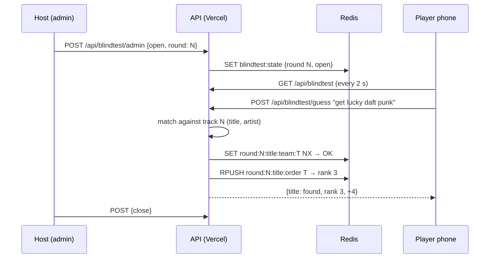

# Every Theodoer plays the blind test from their phone, and the whole team scores when any one of them finds it

> ⚠️ Missing client discussion: Camille has not yet approved the order of the tracks or the accepted answers drafted in [`blindtest_tracks.csv`](./blindtest_tracks.csv).
> ⚠️ Missing designer discussion: there are no mockups. The screens below are described in words, and they reuse the existing `offsite-card` components.

Written 2026-10-01, about 19h30. The game runs on 2026-10-02 around 22h at the bisca evening, for about 20 minutes. The last sound starts the party.

## Why

The usual blind test uses a buzzer. With a buzzer, one fast person per room plays and everyone else watches, so most people stop paying attention after a few sounds. We have 18 teams of 12 people, which is about 216 players (`teams` tab in the production sheet), and the goal of the evening is atmosphere, not finding the best player.

**Objective (engagement):** at least 70% of logged-in team members submit at least one guess during the game. This is measured from the guess log (see *Production strategy*).

The source is the conversation on #blindtest-soiree-bisca on 2026-10-01 (format "buzzer app, custom app, or just shouting", about 20 minutes). Camille's sounds are in the shared Drive folder linked in that channel. That folder holds 21 custom covers, each one a well-known song replayed in an unexpected style (for example *Lose Yourself* by Eminem as country), plus the 21 originals. The answer to each sound is therefore the title and the artist of the original song. 21 sounds in about 20 minutes leaves under a minute per sound, so opening and closing a sound must take one tap each.

## Result

- **Player, `/blindtest`.** The page is hidden until an admin turns the game on, and then a card appears on the home page. When a sound is playing, the player sees one text field: "Titre ou artiste ?". Under it are two lines, *Titre* and *Artiste*. Each line shows "⏳ pas encore trouvé" or "✅ trouvé par Léa, 3e équipe, +4 pts". Between sounds, the player sees the correct answer, the order of the teams for that sound, and the overall ranking.
- **Admin, the "Blind test" section on `/admin`.** It has the buttons *Activer le jeu / Désactiver*, *Lancer le son n°N*, *Fermer le son* and *Publier les scores* (which writes the totals once into the existing `teams | Score` block, so `/scoreboard` keeps working).
- **Big screen, `/blindtest/screen`.** The live arrival order for the current sound, then the overall ranking. It is readable from a distance. We do not yet know whether the bar has a projector, but the page also works on the host's phone.
- The sound is **played by the host on the venue speakers**, not on the phones. Starting audio on 216 phones at the same time is impossible to synchronise, and the bar is loud.

## Use cases / edge cases

Happy path:
1. An admin turns the game on. The home card appears on the next poll.
2. The admin opens sound N and the host starts the music.
3. Every player can type as many guesses as they like. A guess is compared with the title and the artist of sound N. The first correct guess from a team for the title, and separately for the artist, is recorded. Its rank is that team's position among teams that have already found it.
4. Points for each part: `max(1, 11 − rank) / 2`, so 5, 4.5, 4 … down to a minimum of 0.5. A team that finds both parts first scores 10. Every team that finds the answer scores something.
5. Teammates see who found it, at the next poll.
6. The admin closes the sound. The answer and the ranking for that sound are shown to everyone, and the host plays a few seconds of the original.

Edge cases:
- Two players from the same team find it in the same millisecond: `SET NX` accepts exactly one of them. The other sees "déjà trouvé par ton équipe".
- One guess contains both parts ("daft punk get lucky"): both parts are recorded.
- A player is not in a team (a newcomer, or an unmapped email): they see the existing `fallbackMessage` and cannot answer.
- A guess arrives after the sound is closed: it is rejected with "son terminé".
- Spam: at most one guess per player every 1.5 s (`SET NX PX`). The field is disabled while the request is in flight.
- The admin reopens a sound by mistake: opening a sound never erases its earlier results. Only "Remettre à zéro" does, and it asks for confirmation.
- The bar's network fails: plan B is paper slates, with the host noting the order by eye. Slates are printed and handed out before the game starts.

Error cases:
- Redis is unreachable: the API returns 503 and the page shows "Le jeu est en pause, criez vos réponses !".
- The `blindtest_tracks` tab is missing or empty: the admin section says so before anything starts.

## Questions, Options and Decisions

| Question | Options | Decision (2026-10-01) |
| --- | --- | --- |
| Format | Buzzer, paper slates, PWA with free text | **PWA free text, with paper slates as plan B.** Slates with a separate "we answered" button are just a buzzer per team: the button is the race and the slate adds a manual judging step for the host. |
| Storage for live answers | Google Sheet, Upstash Redis | **Upstash Redis.** The Sheets API allows 60 write requests per minute per user per project ([limits](https://developers.google.com/workspace/sheets/api/limits)), and the app writes as a single service account, so 216 players answering together would get `429` errors. The current write pattern (`clear` then `update`) would also overwrite concurrent writes. Redis `SET NX` + `RPUSH` makes "first per team" and the rank atomic. This is a new dependency and a new secret, added from the Vercel marketplace. |
| What counts as correct | Title only, title AND artist, title OR artist | **Title or artist, each worth half the points.** There are two independent races for each sound. |
| How tolerant the matching is | Exact match, fuzzy match | **Fuzzy match.** Both sides are normalised (lowercase, no accents, no punctuation, leading "the/le/la/les" removed). An answer matches if its words appear in the guess, or if the Levenshtein distance is at most `floor(length / 5)`. Answers of 4 characters or fewer must match exactly. Each sound can have aliases. |
| Points scale | 10→1, podium 5/3/2/1, 18→1 | **10, 9, 8 … minimum 1, halved for each part.** |
| How the state reaches the phones | Polling, server-sent events, websockets | **SWR polling: every 2 s while a sound is open, every 10 s otherwise.** Vercel functions do not hold websockets, and polling reuses `use-game.ts`. Each instance caches the shared state for 1 s, so Redis reads do not grow with the number of players. |
| Who owns the rank | The client's clock, the server's arrival order | **Arrival order in Redis.** It cannot be tampered with. The difference between 4G and wifi is small next to the time it takes to type. |

**Out of scope:** playing audio in the app, a final "speed round", showing teammates' wrong guesses, and saving answers offline.

## Changes

**Domain vocabulary:** a *track* is one sound with its accepted titles and artists. A *round* is the window during which one track accepts guesses. A *part* is either the title or the artist. A *claim* is a team's first correct guess for one part of one round, with its rank.

**Sheet (input, edited by Camille):** a new tab `blindtest_tracks` with the columns `order | title | title_aliases | artist | artist_aliases | cover_style | cover_file_id | original_file_id`. Aliases are separated by `;`. The style is shown with the answer. A draft for all 21 tracks is in [`blindtest_tracks.csv`](./blindtest_tracks.csv), ready to paste.

**Redis keys:** `blindtest:state` (JSON `{enabled, round, status}`), `blindtest:r:{n}:{part}:team:{team}` → `email|timestamp` (NX), `blindtest:r:{n}:{part}:order` (list of teams), `blindtest:guesses` (counter, for the metric), `blindtest:players` (set of emails that guessed), `blindtest:cooldown:{email}` (PX 1500).

**Files:**
- NEW `lib/blindtest-match.ts`: pure normalisation and fuzzy matching.
- NEW `lib/blindtest-scoring.ts`: pure, turns a rank into points and claims into totals.
- NEW `lib/blindtest-store.ts`: the Upstash client, the claim, the state and the cache.
- NEW `lib/blindtest-tracks.ts`: reads `blindtest_tracks` through the existing `readGrid` + `cached`.
- NEW `lib/blindtest-types.ts`.
- NEW `app/api/blindtest/route.ts` (GET state for the user), `app/api/blindtest/guess/route.ts` (POST), `app/api/blindtest/admin/route.ts` (POST, with `isAdmin` check).
- NEW `app/(app)/blindtest/page.tsx`, `app/(app)/blindtest/screen/page.tsx`, `components/blindtest/*`, `hooks/use-blindtest.ts`.
- UPDATE `app/(app)/admin/page.tsx` (the blind test section), `app/(app)/page.tsx` (the home card when the game is on), `lib/game-sheets.ts` (export `writeTeamScores` for *Publier les scores*), `.env.example` and `README.md`.

**Test strategy:** the repository has no test runner. We add `vitest` as a dev dependency and cover `blindtest-match` and `blindtest-scoring` completely (accents, typos, aliases, short answers, a guess containing both parts, rank 11 and beyond). A load script, `scripts/blindtest-load.mjs`, fires 216 guesses from 18 teams at the same moment against a preview deployment and checks that exactly one claim exists per team and part, and that the ranks are 1 to 18 with no gaps.

## Production strategy

- **Dry run** on 2026-10-02 in the afternoon, on a preview deployment, with 5 real phones and the load script.
- **Before 22h:** `ADMIN_EMAILS` on Vercel contains Hugo and Camille (changing it needs a redeploy), `blindtest_tracks` is filled in, slates are printed, and a push notification is ready: "Le blind test commence, ouvre l'app 🎵".
- **Analytics:** the `blindtest:players` set divided by the number of team members gives the engagement objective. The number of guesses per round and the median time to the first claim come from the timestamps in the claims.
- **Zero defect:** `console.error` with the prefixes `[blindtest] redis` and `[blindtest] tracks` is visible in the Vercel logs. The host watches the admin section, which shows the live number of guesses. If it stays at 0 for 30 s while a sound is open, switch to the slates.
- **Cost:** Upstash's free tier is 500K commands per month, then $0.2 per 100K ([pricing](https://upstash.com/pricing/redis)). The 1 s cache keeps reads per instance, not per player.
